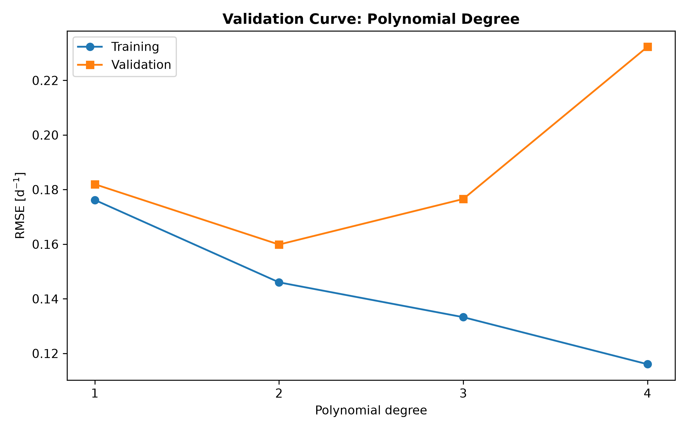
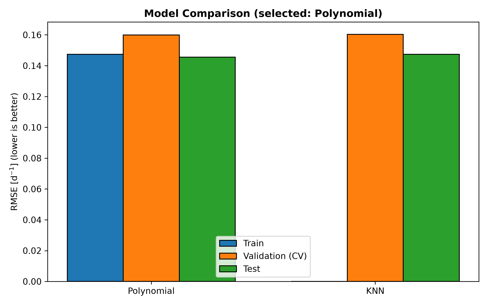
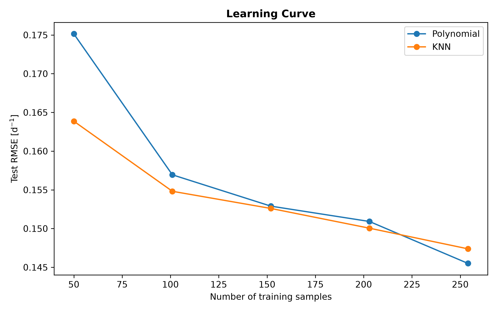
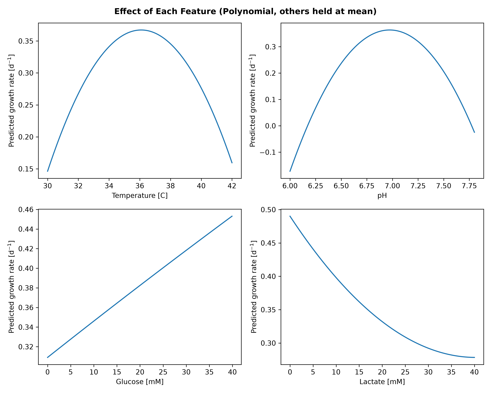
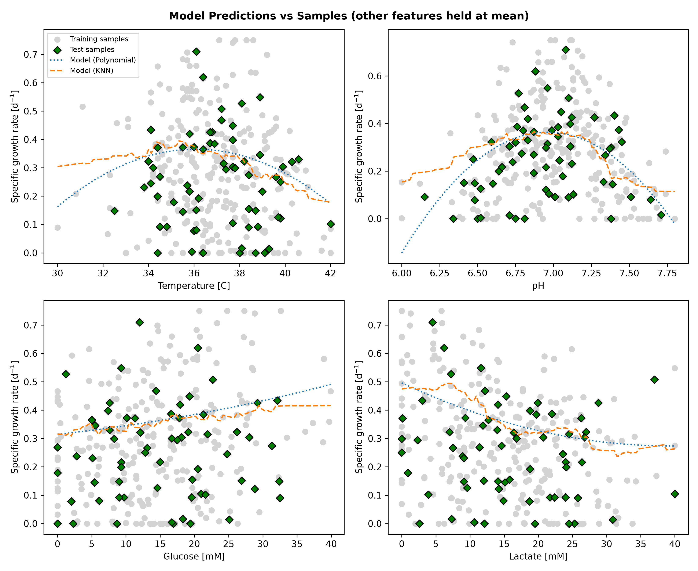

# Cell Growth Rate Predictor
 
This project predicts the specific growth rate of cells in culture from temperature, pH, glucose concentration, and lactate concentration. It trains and compares polynomial and k-nearest neighbors regression models, tunes hyperparameters with cross-validation, and selects the most defensible model. Bioprocess engineers can use it to estimate how culture conditions affect growth, reducing the number of costly experiments needed to find good operating conditions.
 
## Highlights
 
- Built end-to-end regression pipelines with scikit-learn
- Tuned hyperparameters using five-fold GridSearchCV
- Compared polynomial and k-nearest neighbors models
- Diagnosed bias and variance with validation and learning curves
- Visualized model predictions against training and test samples
## Environment
 
- Python 3.14.7
- matplotlib 3.11.2
- numpy 2.5.3
- pandas 3.0.6
- scikit-learn 1.9.1

## Code Design
 
### Configuration and Data Loading
 
When `main.py` runs, it first calculates the optimal pH and temperature as the midpoints of the operating limits stored in a constants module, then creates a `Batch` object. The `Batch` constructor reads the cell growth dataset into a DataFrame and separates the four input features (temperature, pH, glucose, lactate) from the target, the specific growth rate. Loading the data inside the object means every later stage works from the same table and the same column definitions, so a renamed column cannot silently diverge between stages.
 
### Train-Test Split
 
The samples are randomly divided into an 80% training set and a 20% test set using a fixed random seed. This stage exists because a model that is scored on the same samples it learned from looks better than it really is. The test set stands in for future cultures the model has never seen, so it gives an honest estimate of real-world error. The fixed seed makes every run reproducible, which keeps the exported tables and figures consistent with the numbers discussed in this document. The test set is not touched again until models have been tuned and selected.
 
### Model Construction with Pipelines
 
Two model families are built, and each one is a scikit-learn `Pipeline` that begins with a `StandardScaler`. Scaling is necessary because the inputs live on very different scales: temperature spans tens of degrees, pH spans roughly one unit, and the concentrations are in millimolar. Without scaling, large-valued features would dominate polynomial terms and nearest-neighbor distances. Wrapping the scaler and model in one pipeline also guarantees that the scaler is fitted only on the training portion of each cross-validation fold, which prevents information from leaking out of the validation data.
 
The first family is polynomial regression: `PolynomialFeatures` expands the standardized inputs into squared and interaction terms, and `LinearRegression` fits weights to them. A polynomial of degree 1 is ordinary linear regression, so a linear baseline is included automatically. The second family is k-nearest neighbors regression, which predicts the growth rate of a new culture by averaging the growth rates of the most similar training cultures.
 
### Hyperparameter Tuning with Cross-Validation
 
Hyperparameters such as polynomial degree, the number of neighbors, and the weighting scheme cannot be learned during fitting, so they must be searched. `GridSearchCV` tries every combination in a predefined grid and scores each one with five-fold cross-validation on the training set, using root mean square error (RMSE). Averaging over five different validation folds makes the choice far less dependent on one lucky or unlucky split than a single hold-out would be. After the search, the best combination is refitted on the whole training set.
 
This stage also checks whether the winning value sits at the edge of the searched range. If it does, the program prints a note, because the true optimum may lie outside the grid and the range should be widened. The training scores from each fold are retained so that the effect of each hyperparameter on underfitting and overfitting can be plotted later.
 
### Evaluation and Model Selection
 
Each tuned model is scored with RMSE and R² on the training set, the cross-validated validation folds, and the held-out test set. RMSE is reported in the units of the target (d^-1), so it is directly interpretable, and it can be used to compare both model families fairly. Comparing training error with test error shows whether a model is underfitting (both high) or overfitting (training low, test high).
 
The final choice is made using validation RMSE rather than test RMSE, so the test set remains an unbiased judge of the selected model. If the polynomial model performs within 5% of the nearest neighbors model, the polynomial is preferred because its weights can be read and interpreted. The selected model is then refitted on all available data with its best hyperparameters so that no samples are wasted. All metrics are exported to a CSV table in the `tables` folder.
 
### Diagnostics and Visualization
 
Numbers alone do not show how a model behaves, so the program exports several figures to the `figures` folder. A grouped bar chart compares training, validation, and test RMSE for each model. A validation curve plots training and validation RMSE against polynomial degree to show where underfitting turns into overfitting. A set of panels plots both models against the training and test samples while varying one feature at a time with the others held at their mean. Finally, a learning curve repeats the tuning on progressively larger training subsets and records test RMSE, which indicates whether collecting more data would be likely to help. Together these figures are the evidence behind the model choice.
 
### Prediction with Safeguards
 
The last stage uses the selected model to predict the specific growth rate for a new set of culture conditions. Before predicting, the program compares each input with the range found in the training data and prints a warning if any value falls outside it. This safeguard exists because both model families are unreliable when extrapolating: polynomials can oscillate or turn negative, and nearest neighbors simply repeat the closest values they have seen. The result is a prediction that comes with a clear signal about whether it should be trusted.
 
## Analysis
 
### The Selected Model
 
The selected model is a second-degree polynomial regression that uses all squared and interaction terms of standardized temperature, pH, glucose, and lactate. It achieved a cross-validated RMSE of 0.160 d⁻¹, a test RMSE of 0.147 d⁻¹, and a test R² of 0.22. Observed growth rates in the dataset range from 0 to about 0.75 d⁻¹, so the test error corresponds to roughly 19% of the observed range. A model that always predicted the average growth rate would have a test RMSE of about 0.165 d⁻¹ (derived from the test R²), so the model improves on that baseline, but only modestly. The data is noisy, and the model should be read as a description of the average trend rather than a precise forecast for an individual culture. It was trained on 254 samples and evaluated on 64 held-out samples. The full comparison is available in `tables/model_performance_metrics.csv`.
 
### Why Polynomial and Nearest Neighbors Regression
 
Cell growth does not respond to its environment in a straight line. Growth typically peaks at an optimal temperature and pH and falls away on both sides, rises with glucose, and is inhibited as lactate accumulates. A purely linear model cannot represent a peak, so it is expected to underfit. Polynomial regression is the simplest extension that can: squared terms capture a single optimum, and interaction terms let the best temperature or pH shift with the nutrient and waste levels. Its weights are also readable, which matters for a process that people need to understand and troubleshoot.
 
K-nearest neighbors regression takes the opposite approach. It assumes no particular shape and instead lets the data speak, which makes it flexible for abrupt behavior such as growth stopping entirely under poor conditions. Its predictions can never fall outside the range of observed growth rates, so it cannot predict negative growth. The cost is that it cannot extrapolate and does not produce coefficients that explain the effect of each variable.
 
Both families were tuned on the same training data with the same metric and the same five-fold cross-validation, so the comparison is fair.
 
### Comparison with Alternatives
 
| Model      | Best Hyperparameters       | Train RMSE | Validation RMSE | Test RMSE | Train R² | Test R² |
|------------|----------------------------|-----------:|----------------:|----------:|---------:|--------:|
| Polynomial | degree = 2                 |     0.1474 |          0.1599 |    0.1455 |    0.416 |   0.221 |
| KNN        | k = 15, weights = distance |     0.0000 |          0.1603 |    0.1474 |    1.000 |   0.201 |
 
RMSE values are in d⁻¹.
 
**Linear regression as an alternative.** A polynomial of degree 1 is ordinary linear regression. It had a validation RMSE of about 0.182 d⁻¹, roughly 14% worse than degree 2, and its training RMSE of about 0.176 d⁻¹ was also high. High error on both sets indicates underfitting, and it confirms that the relationship between conditions and growth is curved.
 
**Higher polynomial degrees.** Moving to degree 3 raised the validation RMSE to about 0.177 d⁻¹ while training RMSE fell to about 0.133 d⁻¹. At degree 4, validation RMSE jumped to about 0.232 d⁻¹ while training RMSE kept falling to about 0.116 d⁻¹. The widening gap is the signature of overfitting, so degree 2 is the best balance between flexibility and generalization.
 

 
**K-nearest neighbors.** The best KNN model used 15 neighbors with distance weighting. Its training RMSE is exactly zero. This is expected rather than a bug: with distance weighting, each training sample is its own nearest neighbor at distance zero, so the model reproduces the training data perfectly (this is why the KNN training bar is absent from the chart below). Training error is therefore meaningless for this model, and validation error is the only fair measure. KNN's validation RMSE of 0.1603 d⁻¹ is practically identical to the polynomial's 0.1599 d⁻¹, a difference of about 0.3%, and their test RMSE values (0.1474 versus 0.1455 d⁻¹) are similarly close. With only 64 test samples, differences this small are well within random variation.
 

 
**Why the polynomial was chosen.** Because the two models perform almost identically, the choice rests on secondary criteria, which is what the selection rule in the code encodes: if the polynomial is within 5% of the nearest neighbors model's validation RMSE, the polynomial is preferred. It is the better choice for four reasons. First, it is simpler: a degree-2 model with four features has only 14 terms plus an intercept, while KNN must store every training sample. Second, its generalization is more stable: its training and validation errors are close (0.147 and 0.160 d⁻¹), whereas the KNN model drops from zero training error to 0.160 d⁻¹ on new data. Third, its weights can be inspected to see which variables matter, and the effect of each variable can be plotted as a smooth curve. Fourth, it is smooth and compact, which makes it easier to embed in other tools and to explain to colleagues.
 
### Learning Curve and Data Requirements
 
The learning curve shows test RMSE as the training set grows from about 50 to 254 samples.
 

 
The polynomial model improved the most, from 0.175 to 0.145 d⁻¹, because a flexible model needs enough samples to estimate its weights. KNN started lower, at 0.164 d⁻¹, since it needs no fitted shape, and ended at 0.147 d⁻¹. The curves cross at about 220 samples, after which the polynomial is slightly better. Neither curve has fully levelled off, so collecting more data would probably improve both models, though the gains are likely to be modest because the curves are flattening.
 
### Influence of Each Variable
 
The figure below shows the selected model's predicted growth rate as each variable changes with the other three held at their mean.
 

 
- **Temperature:** Growth follows a bell shape, peaking at about 36 °C with a predicted rate near 0.37 d⁻¹ and dropping to about 0.15 d⁻¹ at both 30 °C and 42 °C. This is a strong effect, with a swing of about 0.22 d⁻¹ across the range.
- **pH:** Growth also peaks, at a pH of about 7.0 with a predicted rate near 0.36 d⁻¹, and falls steeply on both sides. It is the strongest effect of the four, with a swing of about 0.5 d⁻¹ across the range. The curve goes below zero at the low end of the pH range, which is not physically possible and reflects the polynomial's limits rather than real behavior.
- **Glucose concentration:** Growth increases roughly linearly with glucose, from about 0.31 d⁻¹ at 0 mM to about 0.45 d⁻¹ at 40 mM. No saturation appears within the sampled range, and the effect is weaker than temperature or pH. The nearest neighbors curve flattens above about 30 mM, which hints at saturation, but samples are sparse there.
- **Lactate concentration:** Growth decreases as lactate accumulates, from about 0.49 d⁻¹ at 0 mM to about 0.28 d⁻¹ at 40 mM. The decline is steepest at low lactate and flattens at high lactate, so the first few millimolar of lactate cost the most growth.
Because the model includes interaction terms, these single-variable curves describe behavior only when the other variables sit at their average. The real optimum can shift as the other conditions change. The scatter of the data in the figure below also shows that, at any given temperature, observed growth rates span almost the entire range from 0 to 0.75 d⁻¹, which means no single variable explains growth on its own.
 

 
### Culture Conditions and Reliability
 
**High specific growth rate.** The highest observed rates (roughly 0.6 to 0.75 d⁻¹) cluster at temperatures of about 34 to 39 °C, a pH of about 6.7 to 7.2, a moderate to high glucose concentration, and a lactate concentration below about 10 mM. The model predicts its highest values in the same region, near 36 °C and pH 7.0, with high glucose and low lactate. However, it predicts conditional averages of about 0.3 to 0.5 d⁻¹ there, so it underestimates the peak values that individual cultures reach.
 
**Low specific growth rate.** Growth is lowest when temperature is near the ends of the range (30 °C or 42 °C), when pH is below about 6.5 or above about 7.5, when glucose is close to zero, and when lactate has accumulated beyond about 25 mM. Many samples show a growth rate of exactly zero, including some at moderate conditions, which suggests that growth can stall entirely because of factors the model does not see.
 
**Where predictions are unreliable.** The model should not be trusted in these cases:
 
- Any input outside the sampled ranges (30 to 42 °C, pH 6.0 to 7.8, 0 to 40 mM glucose, 0 to 40 mM lactate). The program prints a warning in this case.
- The edges of the pH range, where the polynomial produces negative growth rates.
- Sparsely sampled corners of the condition space, such as temperatures below 33 °C or above 41 °C, where few training cultures exist.
- Predictions of the highest growth rates, which the model systematically underestimates.
- Conditions involving variables the model does not include, such as dissolved oxygen, osmolality, or a different cell line.
### Advantages and Limitations
 
**Advantages.**
 
- Hyperparameters were chosen by cross-validation, and the test set was kept separate, so the reported error is an honest estimate.
- Both model families were compared on the same data with the same metric, which makes the comparison fair and reproducible.
- The selected polynomial is compact, fast to train and run, and needs no specialized hardware.
- Its weights and smooth response curves make the effect of each variable easy to inspect and explain.
- Its training and validation errors are close, which suggests stable behavior on new data.
- The extrapolation warning makes the model's boundaries visible to the user.
**Limitations.**
 
- The test R² of 0.22 means the model explains only about a fifth of the variation in growth rate. It captures the broad trends but not most of the culture-to-culture scatter, which probably comes from measurement noise and from factors that are not in the model.
- Only four variables are included, and the data comes from a single dataset, so the model describes only the conditions it has seen.
- The model predicts a growth rate at a single point in time and does not capture how conditions and cells change over a run.
- It returns a single number without an uncertainty estimate, even though the typical error of about 0.15 d⁻¹ is large compared with the effects of individual variables.
- The polynomial can predict negative growth, and many real samples have a growth rate of exactly zero. A natural improvement would be to limit predictions to zero or above.
- The 64-sample test set is small, so the reported test error carries noticeable uncertainty.
### Potential Applications
 
The model can screen candidate culture conditions before running experiments, helping narrow a design of experiments to the most promising region of temperature and pH. It can support setpoint selection and guide feeding strategies by indicating that more glucose helps modestly while accumulating lactate reduces growth. In a monitoring setting, it can provide an expected growth rate for comparison with measured values, so a large deviation flags a problem such as contamination or sensor drift. It can also serve as a growth submodel inside a larger bioreactor simulation.
 
In practice, the model should be used as a guide to trends rather than a replacement for experiments. Predicted optima should be confirmed with a small number of runs, and new results should be added to the dataset so the model can be retrained and its validation repeated.